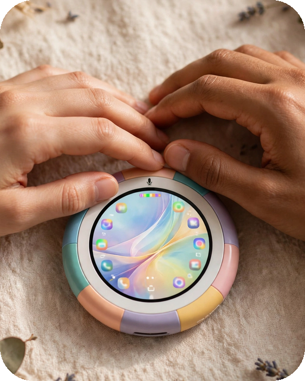

# نشانگر روان (Smooth Cursor)

فارسی | **[English](README.md)**

<p align="center">
  
</p>

یه نشانگر موس برای گوشی اندرویدی که با هر تپ، **نرم می‌لغزه** روی همون نقطه و وقتی رسید، خودش برات کلیک می‌کنه.

کافی است هر جای صفحه رو لمس کنی: نشانگر از جایی که هست، روان حرکت می‌کنه تا نقطه‌ای که زدی و اون‌جا عمل واقعی رو انجام می‌ده — تپ، لانگ‌پرس، اسکرول یا زوم دو انگشتی. بین تپ‌ها هم مثل یه موس واقعی رو صفحه می‌مونه.

## 🎬 مناسب برای ساخت ویدیوهای آموزشی

وقتی با تپ معمولی از صفحه فیلم می‌گیری، بیننده نمی‌بینه کجا رو زدی؛ چیزها خودبه‌خود باز می‌شن. ولی با این نشانگر، هر تپ **دیده می‌شه**: موس می‌ره دقیق روی همون نقطه و اون‌جا کلیک می‌کنه، پس مخاطب راحت دنبالت می‌کنه. برای ویدیوهای آموزشی، آموزش اپ‌ها و ارائه عالیه — و راستش برای استفادهٔ روزمره هم حال می‌ده.

## امکانات

- **تپ، لانگ‌پرس، اسکرول و حرکت دو انگشتی** — همه بعد از لغزش، سر مقصد اجرا می‌شن
- **سرعت لغزش قابل تنظیم** (۳۰٪ تا ۲۰۰٪)
- **تأخیر کلیک قابل تنظیم** (۰ تا ۲۰۰۰ میلی‌ثانیه) — نشانگر رو هدف وامیسته و دقیقاً لحظهٔ کلیک واقعی، خودش هم یه تپ دیداری می‌کنه؛ پس تو فیلم‌هات بیننده دقیق می‌بینه رو چی زدی، قبل از این‌که باز بشه
- **دکمهٔ شناور توقف** — با یه تپ، نشانگر ثابت می‌شه و کل صفحه آزاد می‌شه تا بتونی تند با کیبورد تایپ کنی؛ با تپ دوباره برمی‌گرده. قابل جابه‌جایی هم هست تا جلوی دست‌وپا نباشه
- **۶ شکل آمادهٔ نشانگر** — فلش سفید، فلش مشکی، فلش نارنجی، نشانه‌گیر، حلقه، نقطهٔ لیزری
- **تصویر دلخواه خودت** — هر عکسی از گالریت رو بذار به‌جای موس، اندازش رو تنظیم کن (۴۰٪ تا ۲۰۰٪) و نقطهٔ دقیق کلیکش رو خودت روی تصویر مشخص کن
- **کاملاً روی گوشی** — بدون حساب، بدون سرور، و اپ اصلاً **مجوز اینترنت نداره**

## نصب

1. آخرین APK رو از بخش [Releases](../../releases) دانلود کن.
2. نصبش کن. (Play Protect برای هر اپی که با فایل نصب بشه و سرویس Accessibility داشته باشه یه اخطار ترسناک نشون می‌ده — طبیعیه. برای رد شدنش، موقتاً گزینهٔ «اسکن برنامه‌ها با Play Protect» رو تو پلی‌استور خاموش کن، یا موقع نصب حالت هواپیما رو روشن کن.)
3. اپ رو باز کن و مجوز **«نمایش روی اپ‌ها»** رو بده.
4. **سرویس Accessibility** رو فعال کن. (تو اندروید ۱۳ به بالا، اگه کلیدش خاکستری بود: برنامه‌ها ← Smooth Cursor ← ⋮ ← «اجازهٔ تنظیمات محدودشده».)
5. دکمهٔ **شروع** رو بزن — حالا هر جا تپ کنی، موس می‌لغزه و کلیک می‌کنه.

## چطور کار می‌کنه؟

یه لایهٔ شفاف تمام‌صفحه لمس تو رو می‌گیره و ضبط می‌کنه چی کار کردی — تپ، نگه‌داشتن، مسیر اسکرول یا زوم. بعد نشانگر با انیمیشن می‌ره سمت اون نقطه. لحظهٔ کلیک واقعی، لایهٔ لمسی کلاً از صفحه حذف می‌شه — پس کلیکی که اجرا می‌شه از نظر فیزیکی نمی‌تونه برگرده روی خود اپ (نه حلقه داریم، نه کلیک گم‌شده) — سرویس Accessibility کلیک رو روی اپ زیرین انجام می‌ده و وقتی تموم شد، لایه برمی‌گرده سر جاش.

## مجوزها

| مجوز | برای چی |
| --- | --- |
| نمایش روی اپ‌ها | برای کشیدن نشانگر و لایهٔ لمسی |
| سرویس Accessibility | فقط برای اجرای تپ/کلیک به‌جای تو — هیچ استفادهٔ دیگه‌ای نداره |
| سرویس پیش‌زمینه و اعلان | برای روشن موندن نشانگر، با دکمهٔ توقف تو اعلانش |

بدون اینترنت، بدون تبلیغ، بدون ردیابی، بدون جمع‌آوری داده. سرویس Accessibility محتوای صفحه‌ت رو نمی‌خونه.

## ساخت از سورس

بدون Gradle — ساخت با یه پایپ‌لاین دستی کوچیکه (`aapt2 ← javac ← d8 ← zipalign ← apksigner`)، اون‌قدر سبکه که حتی روی خود گوشی هم می‌شه اجراش کرد (مثلاً توی Termux).

```bash
export JAVA_HOME=/path/to/jdk17
export ANDROID_HOME=/path/to/android-sdk   # platform android-34, build-tools 34.0.0
./build.sh                                  # خروجی: smooth-cursor.apk
```

اسکریپت ساخت دفعهٔ اول یه کلید امضای محلی (`smooth.jks`) می‌سازه. این فایل عمداً تو این ریپو **نیست** — کلید امضات رو هیچ‌وقت منتشر نکن.

## مجوز استفاده

MIT — ببین [LICENSE](LICENSE).
