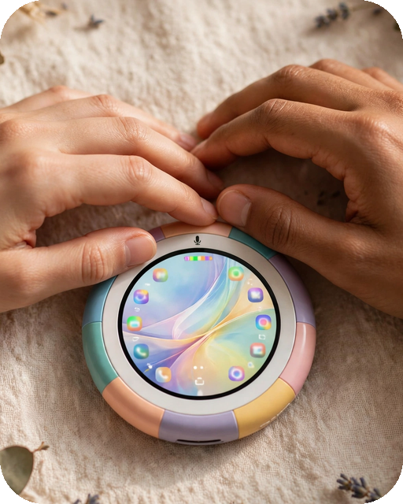

# Smooth Cursor

**[فارسی](README.fa.md)** | English

<p align="center">
  
</p>

A mouse cursor for your Android phone that **glides** to wherever you tap — and clicks for you when it gets there.

Tap anywhere on the screen: the cursor smoothly slides from where it is to your tap point, then performs the real tap (or long-press, scroll, or pinch) at the destination. Between taps it simply stays on screen, like a real mouse pointer.

## 🎬 Great for recording tutorial videos

When you record your screen with ordinary finger taps, viewers can't see where you tapped — things just magically open. With Smooth Cursor, every tap is **visible**: the pointer travels to the exact spot and clicks there, so your audience can follow along easily. Perfect for how-to videos, app tutorials and presentations — and honestly, it's fun to use every day, too.

## Features

- **Tap, long-press, scroll & two-finger gestures** — everything is replayed at the destination after the glide
- **Adjustable glide speed** (30%–200%)
- **Adjustable click delay** (0–2000 ms) — the cursor rests on the target, then visibly presses at the exact moment the real tap fires, so viewers of your recordings see precisely what you tapped before it opens
- **Floating freeze button** — one tap freezes the cursor and frees the whole screen, so you can type fast on the keyboard; tap again to bring the smooth cursor back. It's draggable, so it never gets in your way
- **6 built-in cursor styles** — white arrow, black arrow, orange arrow, crosshair, ring, laser dot
- **Your own cursor image** — pick any picture from your gallery, resize it (40%–200%), and choose its exact click point with the hotspot editor
- **Fully on-device** — no account, no server, and the app has **no INTERNET permission** at all

## Install

1. Download the latest APK from [Releases](../../releases).
2. Install it. (Play Protect shows a scary warning for any sideloaded app that uses an Accessibility service — that's expected. To get past it, briefly turn off "Scan apps with Play Protect" in the Play Store, or install while in airplane mode.)
3. Open the app and grant **"Display over other apps"**.
4. Enable the **Accessibility service**. (On Android 13+, if the switch is greyed out: Apps → Smooth Cursor → ⋮ → "Allow restricted settings" first.)
5. Press **Start** — then tap anywhere and watch it glide.

## How it works

A transparent full-screen overlay layer catches your touch and records what you did — a tap, a hold, a drag path, a pinch. The cursor animates to the target point. For the moment of the real click, the overlay layer is removed from the window manager entirely — so the injected gesture physically cannot land back on the app itself (no loops, no swallowed taps) — an AccessibilityService performs the gesture on the app underneath, and the layer returns when the gesture completes.

## Permissions

| Permission | Why |
| --- | --- |
| Display over other apps | To draw the cursor and the touch layer |
| Accessibility service | To perform the tap/click for you — that is the only thing it is used for |
| Foreground service + notifications | To keep the cursor running, with a stop button in its notification |

No internet, no ads, no tracking, no data collection. The accessibility service never reads your screen content.

## Build from source

No Gradle — the build is a small manual pipeline (`aapt2 → javac → d8 → zipalign → apksigner`), light enough to run even on a phone (e.g. inside Termux).

```bash
export JAVA_HOME=/path/to/jdk17
export ANDROID_HOME=/path/to/android-sdk   # platform android-34, build-tools 34.0.0
./build.sh                                  # produces smooth-cursor.apk
```

The build generates a local signing keystore (`smooth.jks`) on first run. It is deliberately **not** in this repo — never publish your signing keys.

## License

MIT — see [LICENSE](LICENSE).
